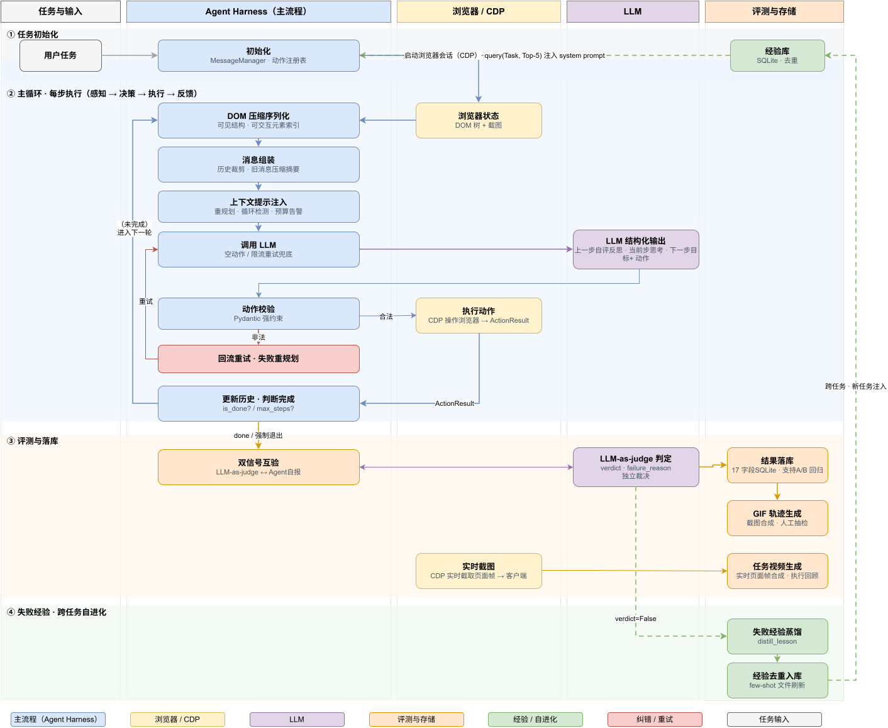
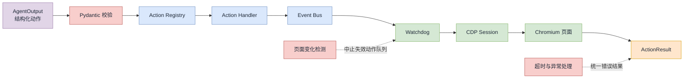
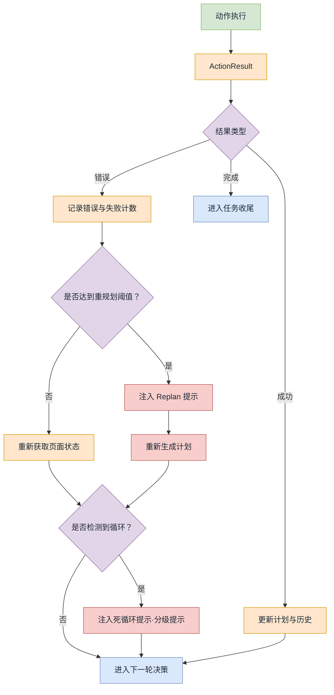
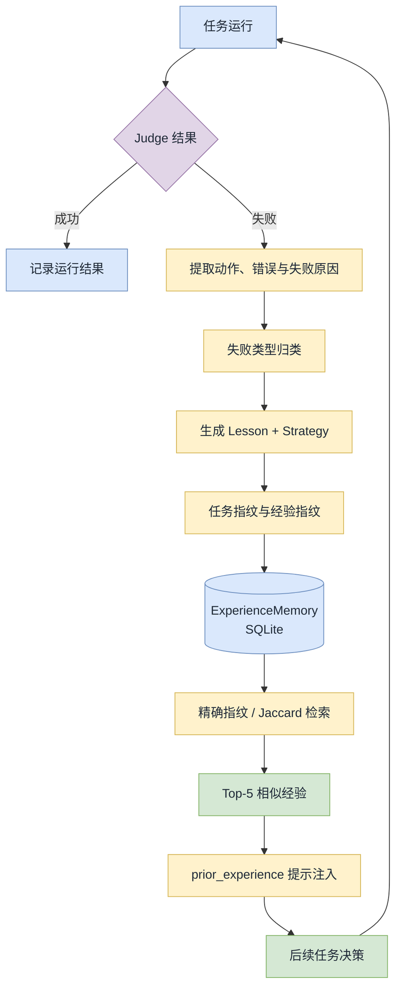

# Browser Agent Harness

> 面向复杂网页长链路任务，构建覆盖**网页感知、结构化决策、动作执行、结果评测与经验复用**的浏览器 Agent 闭环；通过上下文优化、失败重规划和自进化机制，提升任务执行的稳定性与可控性。


## 背景与动机

浏览器 Agent 执行多步任务时，需要持续读取页面、选择操作、观察结果，并根据状态变化调整后续计划。任务链路越长，局部误差越容易传递到后续步骤；网页内容和交互状态不断变化，也让稳定执行与效果评估变得更困难。

⭐ 本项目重点应对四类问题：

### 上下文持续增长

- 网页 DOM 通常包含大量与当前任务无关的节点。若每一步都将完整页面状态放入模型上下文，不仅增加输入规模和推理成本，也可能让关键交互信息淹没在噪声中。

### 动作错误逐步累积

- 页面可能在操作后发生跳转、局部刷新或结构变化，先前观察到的元素和索引随之失效。如果 Agent 重复执行无效动作，错误会沿任务链路累积，最终导致任务偏离目标或陷入循环。

### 任务结果难以稳定评估

- 仅依赖 Agent 自己报告“已完成”，难以判断结果是否真正符合任务要求；缺少统一的轨迹记录和评测方式，也会使不同配置、策略之间的效果难以比较和复查。

### 执行经验难以沉淀复用

- 一次任务中的失败原因和有效策略，如果只留在单次运行历史里，就难以帮助后续相似任务。Agent 需要能够从已完成的运行中提取经验，并在遇到相似场景时检索和复用。

因此，项目围绕“**让浏览器 Agent 看得清、执行稳、结果可评、经验可复用**”展开，构建从页面感知到结果反馈，再到经验沉淀的完整执行闭环。


## 技术路线与系统架构

系统以用户任务为起点，首先初始化 Agent 和浏览器会话，随后，Agent 在每一轮迭代中获取当前浏览器状态，并将其整理为模型可用的上下文。

模型基于当前页面状态、历史动作结果和任务进度，生成结构化决策。动作经过 `Pydantic` 参数校验后，由浏览器执行层完成实际操作，并将执行结果以 `ActionResult` 返回。Agent 根据反馈更新计划、连续失败计数和循环检测状态，同时将页面状态、模型输出、动作结果等信息写入执行历史。若任务尚未完成，系统便基于最新页面状态进入下一轮；若检测到持续失败或动作循环，则提示重新规划，必要时推动任务收敛。

任务结束后，系统结合 Agent 自报结果与 `LLM-as-judge` 的独立判定评估执行效果，并将评测数据写入 SQLite，支持后续查询和 A/B 回归。运行轨迹还可通过 GIF 或视频进行查看和复盘。对于失败任务，系统会提取失败原因和可复用策略，沉淀至经验库；后续相似任务启动时，可检索相关经验并注入上下文，帮助 Agent 调整执行策略。



## 核心模块

### DOM状态压缩与上下文管理

#### 问题

网页 DOM 通常包含大量布局节点、装饰节点、隐藏节点和脚本生成内容。若每轮都将完整 DOM 发送给模型，会带来三个问题：

- 上下文规模持续增长，增加 Token 消耗和推理延迟；
- 关键按钮、输入框和链接容易被无关节点淹没；
- 页面状态变化后，历史消息与当前页面可能出现不一致。

浏览器 Agent 真正需要的不是完整 HTML，而是：

> 📌 当前页面有哪些**可理解、可定位、可操作**的元素，以及它们之间的结构关系。

#### 设计

系统将网页状态处理拆成以下步骤：

```
浏览器原始状态
    ↓
DOM / Accessibility Tree / DOM Snapshot 融合
    ↓
可见性与交互性过滤
    ↓
结构化序列化 + 上下文裁剪
    ↓
LLM 当前决策上下文
```

状态上下文主要包含：

- 当前 URL 和页面标题；
- 页面 DOM 结构；
- 可交互元素及其索引；
- 元素的文本、角色、属性和层级关系；
- 当前页面截图；
- 上一步动作和执行结果；
- 当前任务计划与失败状态。

> 📌 系统同时保留元素的结构关系和交互索引，使模型**既能理解页面语义，也能输出可执行的元素定位信息**。

#### 实现

页面状态由浏览器会话通过 CDP 获取，并在 DOM 服务层完成处理：

1. 获取 DOM、Accessibility Tree 和 DOM Snapshot。
2. 构建统一的增强 DOM 节点。
3. ⭐ 过滤不可见、不可交互或与当前任务无关的节点。
4. ⭐ 保留按钮、链接、输入框、下拉框、复选框等关键交互元素。
5. ⭐ 为可交互元素生成模型可引用的索引。
6. 将处理后的 DOM 序列化为紧凑文本。
7. ⭐ 对消息历史执行裁剪或压缩，控制上下文长度。
8. 根据页面状态变化重新生成当前上下文，避免长期使用过期 DOM。

> 📌 这种处理方式**在上下文成本和页面可操作性之间取得平衡**：**模型看到的是经过筛选和组织的页面状态，而不是未经处理的原始 HTML**。

核心代码主要位于：

```
browser_use/dom/service.py
browser_use/dom/views.py
browser_use/dom/serializer/serializer.py
browser_use/dom/serializer/eval_serializer.py
browser_use/agent/message_manager/
```


### 动作执行链路

#### 问题

模型输出的动作不能直接等价为浏览器操作。一个完整动作需要经过**参数校验、动作路由、元素定位、事件分发和 CDP 执行**等多个环节。

浏览器操作还面临以下不确定性：

- 元素可能不在当前视口内；
- 点击目标可能被其他元素遮挡；
- 页面跳转后，后续动作使用的元素索引可能已经失效；
- 输入组件可能由 React、Vue 等框架控制；
- CDP 请求可能超时或连接中断。

#### 设计

系统采用“**结构化动作 + 注册表 + 事件总线 + Watchdog**”的执行架构：

```
模型动作
→ Pydantic 参数校验
→ Action Registry 路由
→ Action Handler 构造事件
→ Event Bus 分发
→ Watchdog+CDP 执行浏览器操作
→ ActionResult 返回
```

动作执行与具体 CDP 细节解耦：

- Agent 负责决定执行什么；
- Registry 负责查找动作处理器；
- Handler 负责构造标准事件；
- Watchdog 负责处理浏览器交互细节；
- `ActionResult` 负责统一返回结果。

#### 实现

动作执行链路如下：



执行过程中包含多层保护：

1. **动作参数校验**

   所有动作通过 `Pydantic` 模型校验，确保动作名称、参数类型和参数结构符合定义。

2. **元素定位**

   根据页面当前的 `selector map` 查找增强 DOM 节点。

3. **点击安全检查**

   执行点击前检查元素类型、视口位置、遮挡情况和是否需要特殊动作处理。

4. **多级执行策略**

   对普通元素优先使用 CDP 鼠标事件；在坐标不可用、元素被遮挡或 CDP 执行失败时，根据动作类型使用备用执行路径。

5. **多动作中止机制**

   当一个动作导致 URL、标签页或页面焦点发生变化时，系统会停止执行后续依赖旧页面状态的动作，避免使用过期元素索引。

6. ⭐ **超时与错误归一化**

   浏览器连接错误、动作超时、页面元素不可用等异常，统一转换为 `ActionResult(error=...)`，返回给决策层处理，而不是直接终止整个 Agent。

核心实现位于：

```
browser_use/tools/service.py
browser_use/tools/registry/
browser_use/browser/watchdogs/
browser_use/browser/session.py
browser_use/agent/views.py
```


### 反馈与自我纠错

#### 问题

浏览器任务不是一次性规划后执行到底。每个动作都可能改变页面状态，导致原计划失效。常见失败包括：

- 点击了错误元素；
- 元素索引已经过期；
- 页面没有加载完成；
- 动作执行超时；
- 连续重复相同动作；

如果系统只是简单重试同一个动作，失败会不断累积，甚至进入死循环。

#### 设计

系统将每轮执行结果结构化为反馈信号，并维护运行时状态：

```
ActionResult
→ 成功 / 失败 / 提取内容 / 完成信号
→ 更新计划与历史
→ 检查连续失败
→ 检查动作循环
→ 触发重试、重规划或强制收敛
```

纠错机制分为三层：

- **动作级恢复**：处理单个动作的异常和超时；
- **步骤级恢复**：根据当前页面状态重新获取上下文并再次决策；
- **任务级恢复**：连续失败后修改计划，超过阈值后停止无效尝试并保留中间结果。

#### 实现

每轮 Agent 执行主要经过以下阶段：

```
_prepare_context()
    ↓
_get_next_action()
    ↓
_execute_actions()
    ↓
_post_process()
    ↓
_finalize()
```

在 `_prepare_context()` 中，系统会：

- 获取最新浏览器状态；
- 将上一步动作结果加入上下文；
- 更新页面级动作；
- 注入当前计划；
- 检查预算和最大步数；
- ⭐ 检测连续失败；
- ⭐ 检测循环状态；
- 必要时注入 replan 提示。

当连续失败达到配置阈值时，系统向模型加入重新规划提示：

```
REPLAN SUGGESTED:
你已连续失败多次，当前计划可能需要调整。请输出修订后的计划以恢复。
```

此外，系统还会对以下状态进行检测：

- 连续失败次数；
- 相同动作的重复执行；
- 页面 URL 是否发生变化；
- 页面 DOM 状态是否发生变化；
- 任务是否已经达到完成条件；
- 是否达到最大步骤数；
- 是否应该强制调用 `done`。

反馈链路如下：



核心实现位于：

```
browser_use/agent/service.py
browser_use/agent/views.py
browser_use/agent/message_manager/
```


### 多层评测

#### 问题

浏览器 Agent 的“完成”不能只由模型自行判断。Agent 可能报告任务成功，但没有真正完成目标；也可能因为页面限制而提前停止。因此，系统需要同时记录：

- Agent 自己对任务结果的判断；
- 外部评测模型对完整轨迹的判断；
- 可供后续比较和回放的运行数据。

#### 设计

系统采用多层评测机制：

```
Agent 执行
    ├── Agent 自报结果
    ├── LLM-as-Judge 独立判定
    ├── SQLite 结果记录
    └── GIF / 视频回放
```

两类结果互相校验：

- Agent 自报任务完成，Judge 判定成功：正常完成；
- Agent 自报成功/失败，Judge 判定失败/成功：标记为结果不一致；
- Judge 无法给出结果：保留 `unjudged` 状态，不直接归入失败。

#### 实现

👉 **LLM-as-Judge**

Judge 使用独立的评测流程读取：原始任务、Agent 的逐步轨迹、动作结果、页面截图、最终提取内容，输出结构化判定结果【verdict、reasoning ...】

👉 **SQLite 记录与支持A/B回归**

每次任务运行以 run 为单位写入 SQLite。单条记录包含任务、判定、模型、运行时间、步骤数、错误信息、轨迹和版本归因等信息，项目当前按 17 个字段组织运行数据。后续可按任务聚合运行次数、通过数、失败数、未判定数和通过率，并按时间窗口比较基线与新版本的结果差异，支持 A/B 回归分析。

典型字段类别包括：

| 类别     | 示例                                   |
| -------- | -------------------------------------- |
| 任务信息 | task、task_name、source                |
| 结果信息 | verdict、self_reported、judged、reason |
| 模型信息 | model、model_provider                  |
| 运行信息 | duration、n_steps、max_steps           |
| 诊断信息 | action_errors、trace_path、时间戳      |
| 版本归因 | commit 或运行版本信息                  |

👉 **GIF 与视频回放**

系统在运行过程中保存每一步的页面截图、动作和状态，并支持：

- 生成带任务和步骤信息的 GIF；
- 录制浏览器会话视频；
- 保存执行轨迹；
- 对失败任务进行人工复盘；

👉 **离线评测**

⭕ 离线评测使用 **BU Bench V1** 作为固定**任务集**。该评测集包含 5 类 benchmark，共 100 个任务，每类 20 个：

| 任务类别   | 数量 | 覆盖方向               |
| ---------- | ---- | ---------------------- |
| Custom     | 20   | 定制网页交互任务       |
| WebBench   | 20   | 网页浏览与信息处理任务 |
| Mind2Web 2 | 20   | 多步网页导航任务       |
| GAIA       | 20   | 网页问答推理类任务     |
| BrowseComp | 20   | 浏览器环境中的综合任务 |

⭕ 评测时逐条执行任务，并由独立 Judge 输出结构化成功判定和说明。整体**任务成功率**按以下口径统计：

```
Judge 判定成功的任务数 ÷ 实际完成评测的任务数
```

⭕ **实验结果**：总体任务成功率为 **74%**（74/100），五类子集结果如下：

| 类别                                                         | 任务数  | 成功数 | 成功率  |
| ------------------------------------------------------------ | ------- | ------ | ------- |
| InteractionTests（Custom 交互挑战：iframe / 拖拽 / 复杂表单） | 20      | 14     | 70%     |
| WebBenchREAD（WebBench：网页浏览 / 搜索）                    | 20      | 17     | 85%     |
| OM2W2（Mind2Web 2：多步网页导航）                            | 20      | 15     | 75%     |
| GAIA（web 问答 / 多跳推理）                                  | 20      | 13     | 65%     |
| BrowseComp（浏览器综合理解）                                 | 20      | 15     | 75%     |
| **合计**                                                     | **100** | **74** | **74%** |

⭕ 结果分析

- **总览**：74% 的总体成功率表明 harness 的主链路（DOM 压缩 → 动作执行 → 反馈纠错）在真实多步任务上是有效的。

- **WebBenchREAD 最高（85%）**：浏览 / 搜索类最依赖"稳定的 DOM 状态 + 基础点击输入"，对应页面感知与主干执行链的强项，说明基础层较扎实；

- **GAIA 最低（65%）**：问答类瓶颈在多跳推理而非动作执行——harness 能消除动作层错误，但无法补足模型推理上限，这属于模型能力边界而非 harness 缺陷；

- **InteractionTests 70%**：交互挑战（iframe、拖拽、复杂表单）暴露工具链缺口：拖拽等动作类型尚无专用执行路径，表单校验交互易在中间步骤出错；

- **OM2W2 75%**：多步导航仍有错误累积空间——页面变化守卫能拦截"对过期 DOM 操作"，但长链任务中步骤级 Replan 的触发时机仍可优化。

⭕ **Badcase 进一步分析**

| 原因                                                 | 数量 | 对应机制                            |
| ---------------------------------------------------- | ---- | ----------------------------------- |
| 交互执行失败（拖拽 / iframe / 复杂表单无法可靠执行） | 6    | 备用路径未覆盖的动作类型            |
| 观察性与定位失败（重度客户端渲染、动态元素索引漂移） | 5    | DOM 压缩的信息损失面 / 页面变化守卫 |
| 多跳推理不完整（GAIA 类）                            | 7    | 模型能力上限                        |
| 多步错误累积 / 步数预算耗尽（OM2W2 长链）            | 5    | 纠错触发时机                        |
| 外部环境失败（如风控拦截）                           | 3    | judge 按口径判失败，属外部因素      |

⭕ **改进优化思考**

1. **交互执行**：补齐拖拽 / iframe 专用执行路径（备用执行链扩展），复杂表单启用"逐字段填写 + 逐字段校验"模式；

1. **观察性与定位**：对 canvas / 重度客户端渲染页面启用**截图视觉分支与 DOM 压缩并行**，提升动态元素定位稳定性；

1. **GAIA 推理**：问答类任务改为"先检索、后作答"两阶段提示，先把证据收齐再组织答案，缓解边看边答导致的信息不全；

1. **多步累积**：把 Replan 触发阈值前移，连续 1-2 次动作失败即重规划而非等到累积；步数预算按任务类型自适应分配；

-----

多层评测的相关实现位于：

```bash
browser_use/agent/judge.py
browser_use/agent/service.py
browser_use/agent/views.py
browser_use/agent/gif.py
browser_use/browser/video_recorder.py
browser_use/browser/watchdogs/recording_watchdog.py
browser_use/evaluation/
tests/ci/evaluate_tasks.py
tests/ci/evaluate_bu_bench.py
```


### Agent自进化

#### 问题

单次任务结束后，如果执行轨迹只被保存为日志，Agent 无法从失败中获得可复用的行为策略。相似任务仍然需要从头探索，导致：

- 相同类型错误反复出现；
- 失败原因无法转化为下一次决策依据；
- 经验缺少结构化组织；
- 经验库可能出现重复或无关内容。

#### 设计

系统采用“**失败轨迹 → 经验蒸馏 → 相似检索 → 提示注入**”的轻量化自进化机制：

```
失败运行
→ 识别失败类型
→ 提取动作和错误
→ 生成 lesson + strategy
→ 任务指纹化与去重
→ SQLite 持久化
→ 相似任务检索
→ 注入下一次 Agent 上下文
```

📌 该机制不修改模型参数，而是在提示层复用历史经验。经验内容主要包括：任务描述、运行结果、失败原因、最近执行动作、错误信息、建议策略、使用模型、经验出现次数、创建和更新时间。

#### 实现

经验模块位于：

```
browser_use/agent/experience.py
```

具体流程如下。

**1. 任务归一化与指纹生成**

系统对任务文本进行归一化：

- 英文转小写；
- 去除常见停用词；
- 提取有效关键词；
- 对中文任务切分为相邻字词片段；
- 根据关键词集合生成稳定指纹。

相同或高度相似的任务可以映射到相近的任务表示。

**2. 失败经验蒸馏**

任务结束后，系统综合以下信息生成一条经验：

- Agent 自报结果；
- Judge 判定结果；
- failure reason；
- 动作历史；
- ActionResult 错误；
- 执行步数；
- 使用的模型。

系统根据错误内容将失败归类为：

- 超时；
- 登录或认证问题；
- 网络或访问阻断；
- 页面或元素不可用；
- 动作或任务执行失败。

随后生成：

```
lesson：这次任务发生了什么
strategy：下次遇到相似情况应该怎么做
```

例如：

```
Lesson:
任务失败，因为页面导航后目标元素不可用。

Strategy:
在交互前请验证当前的URL和页面内容，并优先使用稳定的选择器，而非重复使用已失效的元素索引。
```

**3. 经验去重与持久化**

经验写入 SQLite 时，**根据任务指纹和 lesson 指纹进行去重**：

- 新经验：插入新记录；
- 相同经验再次出现：增加计数；
- 新策略覆盖旧策略：更新策略和时间；
- 经验可导出为 Markdown few-shot 文件。

**4. 相似任务检索**

查询时采用两级匹配：

```
精确任务指纹匹配
        ↓
关键词 Jaccard 相似度匹配
```

当前相似度阈值为 `0.25`，最多检索 Top-5 条经验。检索结果按**相似度、出现次数和更新时间**排序。

**5. 经验注入**

任务初始化时，系统检索与当前任务相似的历史经验，并将其组织为：

```
<prior_experience>
以下是类似过往任务的提炼要点。除非明确不适用，否则请遵循这些内容。
...
</prior_experience>
```

之后，这些经验被加入 Agent 的系统上下文，影响当前任务的规划和动作选择。

完整闭环如下：



> 📌 这种自进化机制将一次运行中的失败信息转化为下一次任务可使用的决策规则，使 Agent 的改进**从“重新尝试”变成“基于历史经验调整策略**”。


## 代码导航

项目代码按功能划分为以下一级目录：

| 目录           | 功能说明                                                     |
| -------------- | ------------------------------------------------------------ |
| `browser_use/` | Agent、浏览器会话、DOM 感知、动作执行、评测与经验管理等核心实现 |
| `examples/`    | Agent 使用示例与浏览器自动化场景示例                         |
| `tests/`       | 单元测试、集成测试及任务评测相关代码                         |
| `scripts/`     | 开发、构建和维护脚本                                         |
| `bin/`         | 常用环境配置、测试与质量检查脚本                             |
| `docker/`      | Docker 镜像与容器运行相关配置                                |
| `skills/`      | 可供 Agent 使用的技能定义与相关资源                          |


## 快速开始

### 1. 克隆项目并安装依赖

```bash
git clone https://github.com/l6x6y6/BrowserAgent.git
cd BrowserAgent

uv venv --python 3.11
```

激活虚拟环境：

```bash
# Windows PowerShell
.venv\Scripts\Activate.ps1

# macOS / Linux
source .venv/bin/activate
```

安装项目依赖：

```bash
uv sync
```

### 2. 安装 Chromium【可选】

以下命令安装 Chromium 浏览器运行文件，如果本机已有可用的 Chromium/Chrome 浏览器可跳过该步。

```bash
uv run browser-use install
```

### 3. 配置模型 API Key

在项目根目录创建 `.env` 文件，并添加 API Key：

```env
BROWSER_USE_API_KEY=your_api_key_here
```

另外可参考仓库中的 `.env.example` 配置其他可选参数。

### 4. 运行多步任务

创建以下 Python 脚本，或在项目已有示例（`examples/`）基础上运行：

```python
import asyncio
from dotenv import load_dotenv
from browser_use import Agent, ChatBrowserUse

load_dotenv()

async def main():
    agent = Agent(
        task="搜索并比较三种适合初学者的 Python 网页爬虫库，整理它们的特点和官方地址。",
        llm=ChatBrowserUse(),
    )
    history = await agent.run(max_steps=20)
    print(history.final_result())

if __name__ == "__main__":
    asyncio.run(main())
```

运行以上脚本：

```bash
uv run python your_script.py
```

`ChatBrowserUse()` 使用默认模型配置；如需指定模型，可通过 `ChatBrowserUse(model="...")` 设置。

### 5. 查看运行记录【可选】

任务运行期间，Agent 会逐步获取页面状态、生成动作并处理执行反馈。若启用了项目的评测存储配置，运行结果可写入 SQLite；可通过评测 CLI 查看汇总、比较运行区间或检查失败轨迹：

```bash
# 查看评测汇总（按任务统计通过率）
uv run python -m browser_use.evaluation.cli report --db data/eval_results.db
# A/B 对比两个时间点的回归
uv run python -m browser_use.evaluation.cli compare --db data/eval_results.db --baseline <基线时间>
# 导出失败轨迹用于回放分析
uv run python -m browser_use.evaluation.cli traces --db data/eval_results.db --failures
```

`compare` 需要根据实际运行记录提供基线时间或时间范围。若要使用视频录制等可选功能，还需要安装对应的额外依赖；本地视频功能可通过 `uv sync --extra video` 安装。


## 实例演示

### 表单填写

> **Task**：
> 到该网址（ https://httpbin.org/forms/post ）下去完成表单填写，表单所需的信息如下: 
>
> - Customer name: John Doe    
> - Telephone: 555-123-4567    
> - Email: john.doe@example.com    
> - Size: Medium    
> - Topping: cheese    
> - Delivery time: 12:00    
> - Comments: This is a test form submission    
>
> 填完就提交，然后告诉我提交后的页面相应内容。

<video src="./img/表单填写.mp4"></video>

### 高铁班次查询

> **Task**：在中国铁路12306官网上查询上海至杭州2026年11月1日的高铁车次，整理出发时间、到达时间、历时和二等座价格；根据“上午出发、历时较短”的条件推荐 2 个选项

<video src="./img/高铁班次查询.mp4"></video>

### 商品选购比对

> **Task**：打开苏宁易购，搜索"联想笔记本电脑"，滑动并翻页完成所有搜索结果的浏览，在所有搜索结果中，综合销量多、价格适中给我推荐6款笔记本电脑，以列表形式给出名称、品牌、价格与核心配置（处理器、内存、硬盘等）

<video src="./img/商品选购比对.mp4"></video>

### 提取豆瓣数据保存为csv文件

> **Task：**打开豆瓣电影 Top 250（https://movie.douban.com/top250 ），提取里面所有电影（Top 250）的数据：排名、片名、导演与主演、评分、评价人数、一句简介，保存为本地csv文件（豆瓣电影 Top 250.csv）。

<video src="./img/数据抽取-豆瓣.mp4"></video>


## 相关链接

- [CDP](https://chromedevtools.github.io/devtools-protocol/)
- [Pydantic](https://github.com/pydantic/pydantic)
- [browser-use](https://github.com/browser-use/browser-use)
- [WebBench](https://webbench.ai/)
- [BrowseComp](https://cdn.openai.com/pdf/5e10f4ab-d6f7-442e-9508-59515c65e35d/browsecomp.pdf)
- [GAIA](https://huggingface.co/datasets/gaia-benchmark/GAIA)
- [Mind2Web 2](https://openreview.net/forum?id=AUaW6DS9si)


## 常见问题

**Q1：为什么不用 Selenium / Playwright 写固定脚本，而要 LLM Agent？**

**A1**：固定脚本依赖稳定的 selector 与页面结构，页面一改版就失效；而 Agent 每步基于实时压缩的 DOM 状态重新决策，能应对动态布局与跨站任务，任务本身也只需若干句句自然语言描述，无需维护脚本。

**Q2：Agent 自报"任务成功"可信吗？**

**A2**：不可全信，所以评测采用双信号互验：Agent 自报 success 之外，由独立的 LLM-as-judge 只看任务、结果与轨迹重新判定，提示词显式要求"对自报的成功保持怀疑"，两信号不一致会单独告警。

**Q3：密码、身份等敏感信息会进入 prompt 吗？**

**A3**：不会。敏感值在组装消息时统一替换为 <secret> 占位符，落库与日志同样脱敏；需要登录的站点通过浏览器 profile / Cookie 登录态解决，明文不进入上下文。

**Q4：为什么用 SQLite 保存结果，而不是直接使用云数据库或复杂的数据平台？**

**A4**：SQLite 不需要额外部署服务，适合本地开发、快速记录单次运行，也便于随代码一起检查评测结果。当前项目的数据规模和使用方式适合轻量存储。若未来需要多人并发写入、集中化看板或大规模历史数据分析，再考虑迁移到服务端数据库或评测平台。

**Q5：为什么经验库使用任务指纹和 Jaccard 相似度，而不是向量数据库？**

**A5**：任务关键词和 Jaccard 匹配实现轻量、确定、易解释，不需要额外的 embedding 服务或向量数据库，适合快速验证经验检索闭环。相应地，它对语义改写、同义表达和复杂上下文的识别能力有限。任务量或语义匹配需求扩大后，可以评估向量检索，但需要同时考虑索引维护、模型调用成本和经验误召回问题。

**Q6：为什么经验从失败任务中蒸馏，而不是把所有成功轨迹都存下来供模型学习？**

**A6**：失败经验通常能直接揭示需要规避的错误模式，蒸馏为简短策略后也更容易复用。保存所有成功轨迹会快速增加存储和提示长度，并可能把特定网站的偶然路径带入不相关任务。当前做法更轻量，但也意味着成功策略的复用较少；后续可在验证成功轨迹具有稳定复用价值后，再增加选择性沉淀机制。

**Q7：如何处理需要登录等身份验证？**

**A7：**优先复用已登录的本地浏览器会话。可以配置 `Browser` 使用本机 Chrome 的 `executable_path`、用户数据目录 `user_data_dir` 和对应的 `profile_directory`，让 Agent 通过现有浏览器配置访问已登录的网站。启动自动化前，需先完全关闭正在运行的 Chrome，避免浏览器配置文件被占用。

如果使用新的浏览器会话，可通过 `storage_state` 加载预先保存的 Cookie 和本地存储状态。若登录过程中遇到验证码或需要本人确认的验证，暂停 Agent 操作，由用户完成验证；之后再检查页面状态并继续任务。
